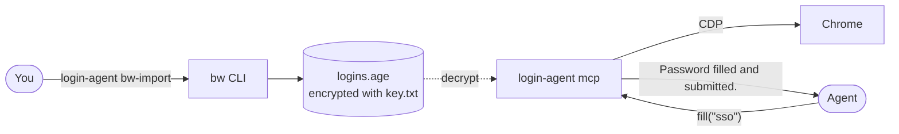

# login-agent

Lets an agent log in to sites in a Chrome it drives over CDP, using logins you pick from Bitwarden. The agent never sees a username, password, TOTP seed, or code.

## Quickstart

Needs Deno 2 and the Bitwarden CLI. Install login-agent and log in to Bitwarden:

```bash
mise use -g bitwarden
deno install jsr:@canac/login-agent --global --reload --force \
  --allow-env --allow-read --allow-write --allow-net --allow-sys --allow-run=bw,fzf
bw login
```

Import logins in your own terminal, since it prompts for your master password:

```bash
login-agent bw-import    # pick one in fzf, or list what's in Bitwarden
```

Give the agent its own Chrome with a debug port and a dedicated profile:

```bash
"/Applications/Google Chrome.app/Contents/MacOS/Google Chrome" \
  --remote-debugging-port=9222 --user-data-dir="$HOME/.chrome-login-agent"
```

Add the MCP server, for example to Claude Code:

```bash
claude mcp add login-agent -- login-agent mcp --cdp-endpoint http://127.0.0.1:9222
```

login-agent only fills logins. The agent also needs a way to navigate and click in that Chrome, such as Playwright MCP on the same endpoint:

```bash
claude mcp add playwright -- npx @playwright/mcp@latest --cdp-endpoint http://127.0.0.1:9222
```

Only import logins for dedicated agent accounts. See [What it doesn't guarantee](#what-it-doesnt-guarantee).

## Importing

On its own, `login-agent bw-import` lists the vault's login items, one per line: the item id, then its https URLs (username). If [fzf](https://github.com/junegunn/fzf) is installed and the output is a terminal, it opens that list in fzf instead and imports the one you pick. Or import one by id. Each is stored under a slug of the item's name on its https URLs; override either when needed:

```bash
login-agent bw-import 11111111-aaaa-4bbb-8ccc-000000000002 --alias gh --origin https://github.com --origin http://localhost:4100
login-agent list    # stored aliases and origins, nothing secret
```

After changing a login in Bitwarden, run `bw-import` again; it replaces the stored copy. Importing by id works from a script once `BW_SESSION` is set.

`bw-import` unlocks the vault with `bw unlock` if `BW_SESSION` isn't set, syncs it, then reads items with `bw list items` or `bw get item <id>`. Everything is checked before writing: an item without an https URL needs `--origin`, and an authenticator key that isn't base32 or `otpauth://totp` (such as `steam://`) is refused.

## How it works



`login-agent bw-import` copies the logins you choose out of Bitwarden into one age-encrypted file. Whatever starts `login-agent mcp --cdp-endpoint <url>` over stdio chooses the Chrome it fills in. Each `fill` call decrypts that file, finds the one tab on the login's origin, fills whatever the page asks for, submits, and returns a short outcome message. Nothing is cached between calls, so a new import applies on the next call.

### MCP tools

| Tool          | Returns                                                                           |
| ------------- | --------------------------------------------------------------------------------- |
| `list_logins` | Each alias with its origins and `hasTotp`.                                        |
| `fill(alias)` | Fills and submits whatever the current page asks for, then reports what happened. |

How `fill` decides:

- It refuses if no tab is on one of the login's origins, or if more than one visible tab is.
- A password field on the page: fills the username too if there's a username field, then the password.
- Otherwise a username field: fills the username.
- Otherwise a verification code field: fills the current TOTP code.
- It presses Enter and waits for the field to go away. If it's still there, or shows up again after a reload, it clears it and says the form is still showing.
- Calls run one at a time.

Multi-page logins take one call per page. For example, an SSO login: `fill("sso")` on the username page, `fill("sso")` on the password page, the agent clicks the authenticator itself, then `fill("sso")` on the code page.

### Files

`~/.config/login-agent/` (mode 700; override with `LOGIN_AGENT_CONFIG_DIR`):

- `key.txt` (mode 600): an age X25519 identity, created on the first import.
- `logins.age` (mode 600): `{ "<alias>": { "origins": [...], "username", "password", "totp" } }`, encrypted to that key. It's a standard age file: `age -d -i key.txt logins.age` opens it.

## Security

### What it guarantees

- No secret ever appears in a tool result, an error message, or a log line. Usernames show only in `login-agent bw-import`'s list of vault items, so you can tell logins apart.
- Only imported logins exist, and each only fills on its listed origins. login-agent checks the real page URL from CDP and types into an element pinned to that document, after checking the element's own origin, so a page that navigates away mid-fill fails instead of filling somewhere else.
- The TOTP seed never reaches the page. Only a 30-second code does.
- Bitwarden is only touched during `bw-import`. `BW_SESSION`, which opens the whole vault, exists only while it runs, and only `bw` gets it.

### What it doesn't guarantee

- **The agent could decrypt the file itself.** `key.txt` sits next to `logins.age`, readable by your user, and the agent runs as your user. login-agent stops _accidental_ exposure, not an agent that goes looking. So import only logins for dedicated agent accounts, and keep those in a Bitwarden account that holds nothing else.
- While a fill is in progress the password is in the page's DOM for a moment. An agent that can also run JavaScript in the tab could capture it, so tell it not to on login tabs; nothing enforces that.

## Development

`deno task install` installs the `login-agent` command from a checkout, so code changes apply right away; run it again after changing dependencies.

```bash
mise install        # age, for the test that decrypts the store with the age CLI; lefthook
mise run setup      # install the pre-commit hooks
deno task check
deno task test      # unit: store (round trip, wrong key, schema, age CLI interop), import helpers, TOTP RFC 6238 vectors
deno task test:e2e  # fill: headless Chrome + local test site over real stdio MCP; import: fake bw
```

The fill suite starts a headless Chrome with a debug port, a local site with one-page, two-step, OTP-only, stuck, wrong-origin, redirect, and mid-fill navigation pages, and `login-agent mcp` as Claude Code would. It asserts the site got the sentinel credentials and TOTP code, and that no MCP response or log line contains any of them. Set `CHROME` if Chrome isn't at the usual macOS path. The import suite uses a fake `bw` in `test/fixtures/bw-bin`.
